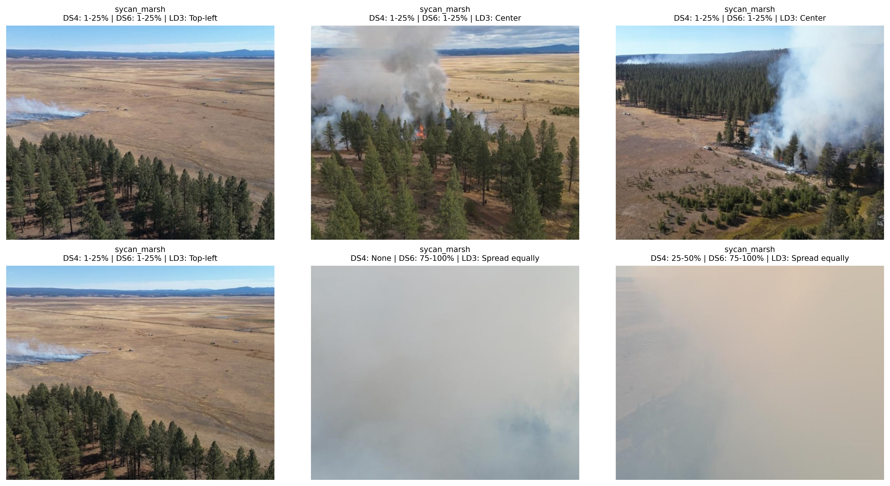
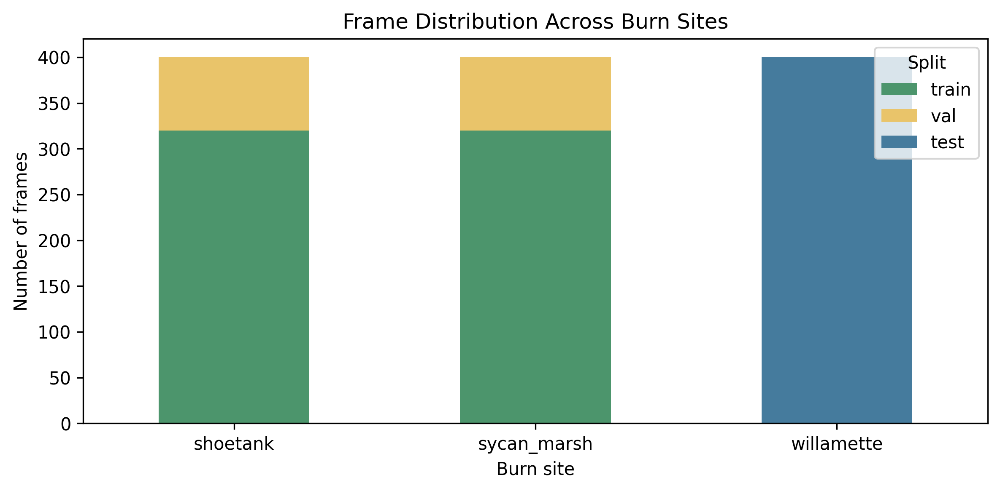
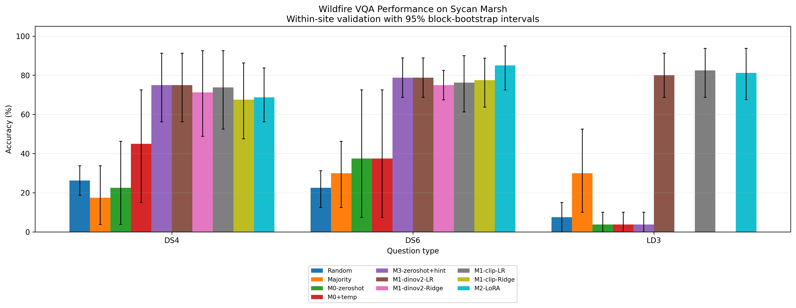
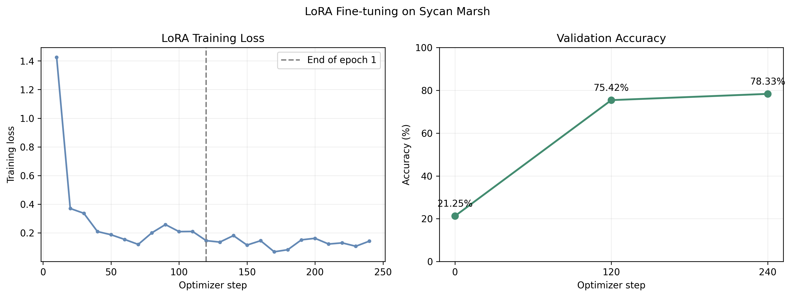
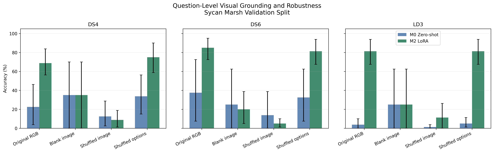
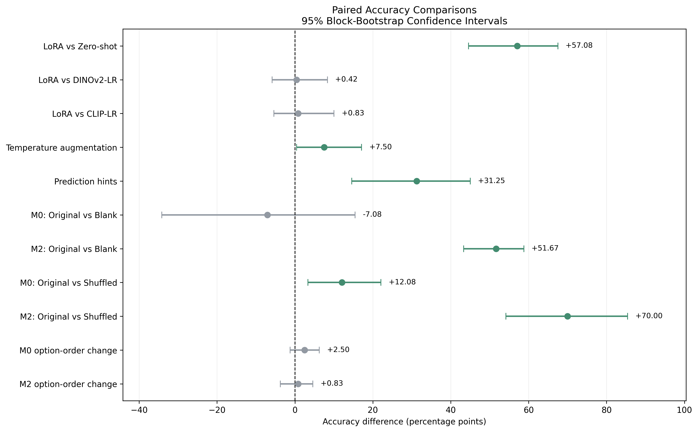
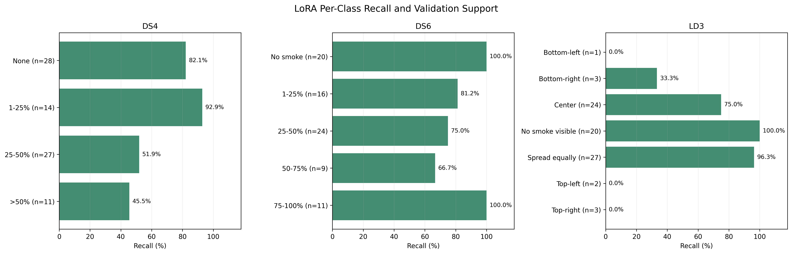
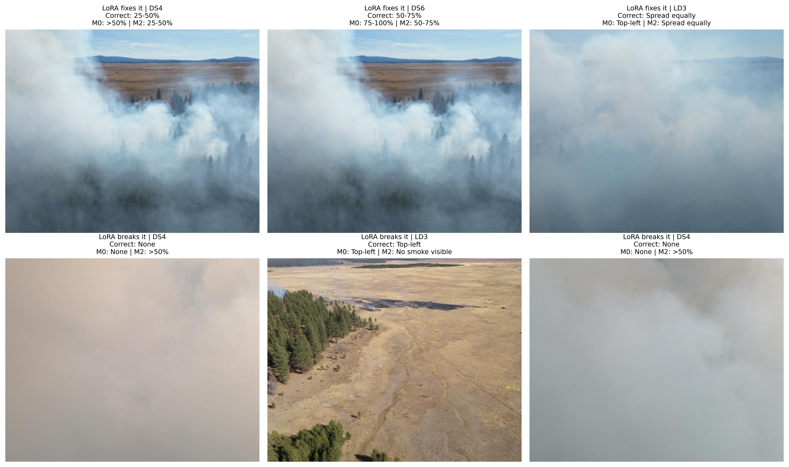

<div align="center">

# Visual Grounding and Parameter-Efficient Adaptation for Wildfire Visual Question Answering

### A Pilot Study on FLAMEVQA

**Sajjad Ahmad**

November 2026

</div>

## Overview

This repository presents an exploratory study of vision-language models for aerial wildfire visual question answering using the FLAMEVQA benchmark.

The study investigates zero-shot inference, frozen visual representations, thermal information augmentation, classifier-guided prediction, and parameter-efficient fine-tuning. It further examines visual grounding, answer-order robustness, statistical uncertainty, and class-level performance.

The completed experiments focus on a within-site validation split of Sycan Marsh.

<p align="center">
  
</p>

<p align="center">
  <em>Representative RGB samples from the Sycan Marsh dataset.</em>
</p>

## Research Objectives

- Evaluate zero-shot vision-language model performance on wildfire imagery.
- Investigate frozen DINOv2 and CLIP visual representations.
- Examine the contribution of radiometric thermal statistics.
- Adapt a pretrained vision-language model through LoRA.
- Investigate classifier-guided prediction.
- Evaluate visual grounding and answer-order robustness.
- Analyze statistical uncertainty and class-level limitations.

## Dataset

The annotation dataset contains 207,287 valid question-answer records associated with 6,097 distinct frames across three prescribed burn sites.

| Burn Site | Frames |
|---|---:|
| Shoetank | 3,540 |
| Sycan Marsh | 738 |
| Willamette | 1,819 |
| **Total** | **6,097** |

Three question types are considered in this study:

| ID | Task |
|---|---|
| DS4 | Estimation of vegetation affected by fire |
| DS6 | Estimation of smoke obstruction |
| LD3 | Localization of the largest smoke plume origin |

Due to image availability, the completed experiments use 400 selected frames from Sycan Marsh.

| Split | Frames | Questions |
|---|---:|---:|
| Training | 320 | 960 |
| Validation | 80 | 240 |
| **Total** | **400** | **1,200** |

<p align="center">
  
</p>

## Methodology

The experimental framework consists of four primary modeling approaches and additional controlled experiments.

| Method | Description |
|---|---|
| M0 | Zero-shot Qwen3-VL-2B-Instruct |
| M0 + Temp | Zero-shot inference with thermal statistics |
| M1 | Frozen DINOv2 and CLIP features with trained prediction heads |
| M2 | Parameter-efficient LoRA fine-tuning |
| M3 | Zero-shot inference with classifier-generated hints |

Random and majority-class predictions are included as baseline methods.

## Experimental Results

Accuracy (%) on the Sycan Marsh validation split:

| Method | DS4 | DS6 | LD3 | Overall |
|---|---:|---:|---:|---:|
| Random | 26.25 | 22.50 | 7.50 | 18.75 |
| Majority | 17.50 | 30.00 | 30.00 | 25.83 |
| M0 Zero-shot | 22.50 | 37.50 | 3.75 | 21.25 |
| M0 + Temperature | 45.00 | 37.50 | 3.75 | 28.75 |
| M1 DINOv2-LR | **75.00** | 78.75 | 80.00 | 77.92 |
| M1 DINOv2-Ridge | 71.25 | 75.00 | — | — |
| M1 CLIP-LR | 73.75 | 76.25 | **82.50** | 77.50 |
| M1 CLIP-Ridge | 67.50 | 77.50 | — | — |
| M2 LoRA | 68.75 | **85.00** | 81.25 | **78.33** |
| M3 + Hints | **75.00** | 78.75 | 3.75 | 52.50 |

<p align="center">
  
</p>

<p align="center">
  <em>Model comparison with 95% block-bootstrap confidence intervals.</em>
</p>

## Parameter-Efficient Fine-Tuning

Qwen3-VL-2B-Instruct was adapted using Low-Rank Adaptation (LoRA), while keeping the original model weights and vision encoder frozen.

| Configuration | Value |
|---|---|
| LoRA Rank | 16 |
| LoRA Alpha | 32 |
| Learning Rate | 1e-4 |
| Epochs | 2 |
| Gradient Accumulation | 8 |
| Trainable Parameters | 6,422,528 |
| Trainable Parameter Percentage | 0.301% |
| GPU | NVIDIA Tesla T4 |
| Training and Validation Time | 19.13 minutes |

LoRA adaptation improves overall accuracy from 21.25% to 78.33%, corresponding to an improvement of 57.08 percentage points.

<p align="center">
  
</p>

## Visual Grounding and Robustness

Controlled experiments were conducted to investigate the dependence of model predictions on relevant visual information and answer-option ordering.

| Input Condition | Zero-shot | LoRA |
|---|---:|---:|
| Original RGB | 21.25 | 78.33 |
| Blank Image | 28.33 | 26.67 |
| Shuffled Image | 9.17 | 8.33 |
| Shuffled Options | 23.75 | 79.17 |

The substantial reduction in LoRA accuracy under blank and shuffled image conditions provides evidence of dependence on relevant visual information.

The fine-tuned model also achieves 93.33% prediction consistency under the evaluated answer-option permutation, compared with 76.67% for the zero-shot model.

<p align="center">
  
</p>

## Statistical Analysis

Paired block-bootstrap resampling was performed using 10,000 resamples to estimate accuracy differences between methods.

| Comparison | Difference (pp) | 95% CI |
|---|---:|---|
| LoRA vs Zero-shot | +57.08 | [44.58, 67.50] |
| LoRA vs DINOv2-LR | +0.42 | [-5.83, 8.33] |
| LoRA vs CLIP-LR | +0.83 | [-5.42, 10.00] |
| Temperature Augmentation | +7.50 | [0.42, 17.08] |
| Prediction Hints | +31.25 | [14.58, 45.00] |
| LoRA Original vs Blank | +51.67 | [43.33, 58.76] |
| LoRA Original vs Shuffled | +70.00 | [54.17, 85.42] |

Although LoRA substantially improves zero-shot performance, the comparisons do not establish clear superiority over frozen-feature classifiers.

The confidence intervals are exploratory and unadjusted, based on eight validation blocks.

<p align="center">
  
</p>

## Class-Level Performance

Macro-F1 scores provide additional insight into model performance under class imbalance.

| Method | DS4 | DS6 | LD3 |
|---|---:|---:|---:|
| Zero-shot | 16.55 | 25.60 | 8.04 |
| DINOv2-LR | 71.57 | 78.16 | 36.51 |
| CLIP-LR | 71.29 | 75.55 | 37.66 |
| LoRA | 65.29 | 83.65 | 44.20 |

Despite achieving 81.25% accuracy on LD3, the fine-tuned model obtains a macro-F1 score of 44.20%, indicating continued difficulty with rare spatial answer categories.

<p align="center">
  
</p>

## Qualitative Analysis

Representative examples illustrate cases where LoRA adaptation corrects zero-shot predictions, as well as cases where adaptation introduces new errors.

<p align="center">
  
</p>

## Key Findings

- LoRA improves overall accuracy by 57.08 percentage points while training approximately 0.301% of the model parameters.
- Frozen DINOv2 and CLIP classifiers remain competitive with VLM fine-tuning.
- Thermal statistics primarily improve vegetation coverage estimation.
- Classifier-generated hints improve ordinal estimation but do not improve smoke plume localization.
- Blank and shuffled image controls provide evidence of visual information dependence.
- Fine-tuned predictions remain relatively stable under answer-option reordering.
- Rare spatial answer categories remain challenging.

## Limitations and Future Work

The completed experiments represent a within-site pilot study rather than a complete cross-site benchmark.

Current limitations include:

- Unavailable imagery from Shoetank and Willamette.
- Absence of an independent final test set.
- Limited number of validation blocks.
- Potential temporal dependence between frames.
- Imbalanced spatial answer categories.
- Single-permutation robustness experiments.

Future work will investigate cross-site generalization, class-balanced learning, repeated robustness experiments, and more comprehensive RGB-thermal integration.

## Repository Structure

```text
flamevqa-visual-grounding-study/
├── README.md
├── notebooks/
│   └── FLAMEVQA_Visual_Grounding_Study.ipynb
├── results/
│   ├── main_table.csv
│   ├── classification_metrics.csv
│   ├── per_class_metrics.csv
│   ├── robustness_summary.csv
│   └── paired_statistical_summary.csv
└── figures/
```

## Acknowledgments

This study was conducted as an independent research investigation following discussions with researchers at Clemson University.

I acknowledge the authors of FLAMEVQA and WildFireVQA for their contributions to aerial wildfire monitoring and for making the annotation dataset publicly accessible.

## References and Resources

- [FlameVQA: A Physically-Grounded UAV Wildfire VQA Benchmark with Radiometric Thermal Supervision](https://arxiv.org/abs/2606.27128)
- [WildFireVQA: A Large-Scale Radiometric Thermal VQA Benchmark for Aerial Wildfire Monitoring](https://arxiv.org/abs/2604.20190)
- [WildFireVQA Dataset](https://huggingface.co/datasets/mobiiin/WildFire_VQA)
- [Qwen3-VL](https://github.com/QwenLM/Qwen3-VL)
- [DINOv2](https://github.com/facebookresearch/dinov2)
- [CLIP](https://github.com/openai/CLIP)
- [LoRA: Low-Rank Adaptation of Large Language Models](https://arxiv.org/abs/2106.09685)

## Author

**Sajjad Ahmad**

Research interests: Multimodal AI, Computer Vision, Vision-Language Models, and Intelligent Systems.

[GitHub](https://github.com/sajjadahmad-dev) |
[LinkedIn](https://www.linkedin.com/in/sajjadahmad-dev/) |
[Portfolio](https://sajjad-ahmad-ai.vercel.app/)
